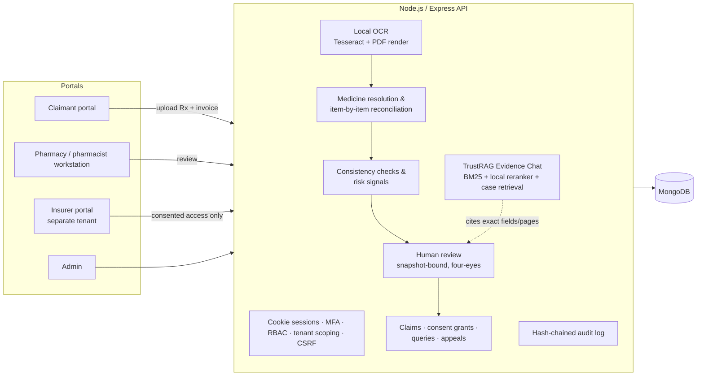

# PharmaVault TrustRAG

Evidence-grounded prescription, pharmacy-invoice and health-claim verification with human review, an insurer portal and a cited Evidence Chat.

> **Final-year major project · academic prototype.** Synthetic data only. Not for clinical use or real patient data.

[](https://github.com/aniket889999/NEWPHARMAVAULT/actions/workflows/claims-platform.yml)
[](https://github.com/aniket889999/NEWPHARMAVAULT/actions/workflows/e2e.yml)

## The problem

Health claims for medicines need someone to check that the prescription, the pharmacy invoice and the claim agree: same medicine, strength, form and quantity. That check is manual, slow and hard to audit. PharmaVault automates the evidence gathering and leaves every decision to a human.

## How it works



1. **Claimant** creates a case and uploads a prescription and invoice.
2. **Local OCR** extracts fields; low-confidence fields are corrected by the user.
3. Medicines are **resolved and reconciled** item by item (strength, form, release type, quantity/pack). Mismatches raise **risk signals** — review prompts, not fraud verdicts.
4. **Evidence Chat (TrustRAG)** answers questions about the case with citations to exact fields and pages, and marks answers **stale** when a cited field is later corrected.
5. A **pharmacist** verifies, returns or escalates. The decision is bound to a snapshot of the evidence and audited. The person who uploaded cannot verify (four-eyes), unless a one-pharmacist store has opted in with explicit confirmation.
6. The claimant **submits a claim to an insurer** with explicit, revocable consent. The insurer reviews, raises queries and records a human decision; the claimant may **appeal once**, decided by a different insurer user.

**AI never diagnoses, prescribes or approves/rejects a claim. Humans decide; every decision has a note and is audited.**

## What is in the product

| Area | Highlights |
| --- | --- |
| Verification | OCR + correction, item reconciliation, risk signals, snapshot-bound review, assignment lease, reopen, four-eyes |
| Evidence Chat | Case-bound retrieval with exact citations, signed freshness (stale on correction), approved public sources for general questions |
| Claims & insurer | Separate insurer tenant, consent grants, queries, partial approval, appeals, draft FHIR R4 export (NHCX-aligned), simulated settlement |
| Security | HttpOnly cookie sessions, CSRF, RBAC + tenant isolation, TOTP MFA with QR + recovery codes, per-source login lockout, staff deactivate/role/sign-out |
| Audit & privacy | Tamper-evident hash-chained audit log, data download (readable + JSON), erasure requests, retention, encryption at rest |
| Usability | English / हिन्दी, opt-in SMS/WhatsApp alerts, in-app confirmations |
| Operations | Request IDs, JSON logs, Prometheus metrics, backups/restore scripts, runbook |

Supporting modules (doctor consult, nearby availability, health tracker, reminders, authenticity check, ledger, analytics, billing) run on the platform's own seeded synthetic data; they are not connected to external providers (doctors, live pharmacy stock, CDSCO, payment gateways).

## Evaluation (measured, with denominators)

| What | Result | Scope |
| --- | --- | --- |
| Wrong-medicine source selection (held-out) | **9/16 → 0/16** with item-scoped retrieval | 16 synthetic held-out scenarios, frozen before scoring |
| Requested-field recall@4 (held-out) | 16/30 (53.3%) for all variants | Item scope fixed attribution but did not raise recall |
| Stale answer after cited correction | **16/16 detected, 0/16 false stale** on unrelated edits (whole-case invalidation: 16/16 false stale) | Signed content dependencies |
| Automated tests | Backend unit + real-MongoDB integration, contract parity, protected regressions, Playwright end-to-end (2 full claim journeys incl. appeal) — green in CI | Synthetic data |

Details: [research results](docs/rag-v2/SESSION_5_RESEARCH_RESULTS.md) · [integration audit](docs/PROJECT_INTEGRATION_AUDIT.md) · [version-3.0 notes](docs/version-3.0/README.md).

## Run it locally

Needs Node.js 22 and Git.

```bash
git clone https://github.com/aniket889999/NEWPHARMAVAULT.git && cd NEWPHARMAVAULT
npm install && npm --prefix backend install
# create backend/.env from backend/.env.example (MONGO_URI, JWT_SECRET, MFA_ENCRYPTION_KEY, GEMINI_API_KEY=local-not-used)
npm --prefix backend run mongo:local          # terminal 1, keep open
npm --prefix backend run seed:demo            # terminal 2
npm --prefix backend run seed:showcase
npm run dev:all                               # open http://localhost:5173
```

Demo accounts (password `password123`, all fictional):

| Role | Email |
| --- | --- |
| Claimant — Ananya Verma | `ananya.verma@claimant.example` |
| Insurer reviewer — Sahyog Health Assurance (Demo) | `rohit.mehta@sahyog-health.example` |
| Insurer admin (appeals) | `kavya.iyer@sahyog-health.example` |
| Patient / pharmacy / staff (generic) | `patient@test.com`, `pharmacy@test.com`, see the login page |

## Stack

React 18 · TypeScript · Vite · Tailwind · Zustand · Node 22 · Express · MongoDB/Mongoose · Tesseract.js · OpenAPI 3.1 + JSON Schema contracts · node:test + Supertest · Playwright · GitHub Actions · Docker.

## Limitations (honest)

- **OCR accuracy is not yet measured** on a labelled set; Tesseract is weak on handwriting and non-English text; PDFs are limited to 3 pages.
- **Chat recall is modest** (53% on a small synthetic held-out set) and answer faithfulness is not human-rated yet.
- Medicine matching uses an academic catalogue, not a national drug registry.
- Insurer settlement and NHCX connectivity are simulated; FHIR export is a draft.
- Hindi is a first draft (needs native review) and covers claimant and security screens only.
- Not deployed to a public server; no external penetration test or legal review; no real-user trials yet.
- Supporting modules use seeded synthetic data and are not connected to external providers.

## Future work

1. Labelled OCR benchmark (field-level precision/recall) and handwriting/Hindi OCR.
2. Hybrid retrieval (BM25 + embeddings) with item-scoped re-ranking; larger independently authored test set and faithfulness rating.
3. Browser test of the full pharmacist upload → verify flow; load, security-scan and accessibility tests in CI.
4. Staging deployment with HTTPS, restore drill, and a small pilot with pharmacists and claimants.
5. Real insurer integration (NHCX sandbox) and drug-registry mapping.

## Team

- **Aniket Panchal** — Evidence Chat / TrustRAG, OCR and reconciliation, research evaluation, iOS client.
- **Samarth Agarwal** — Claims and insurer portal, reviewer workflow, security (MFA, audit chain, lockout), privacy rights, operations and CI.

Engineering history and session handoffs are kept under [`docs/`](docs/) for traceability.
