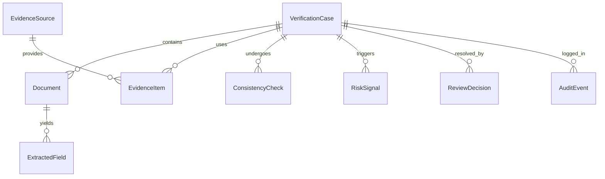
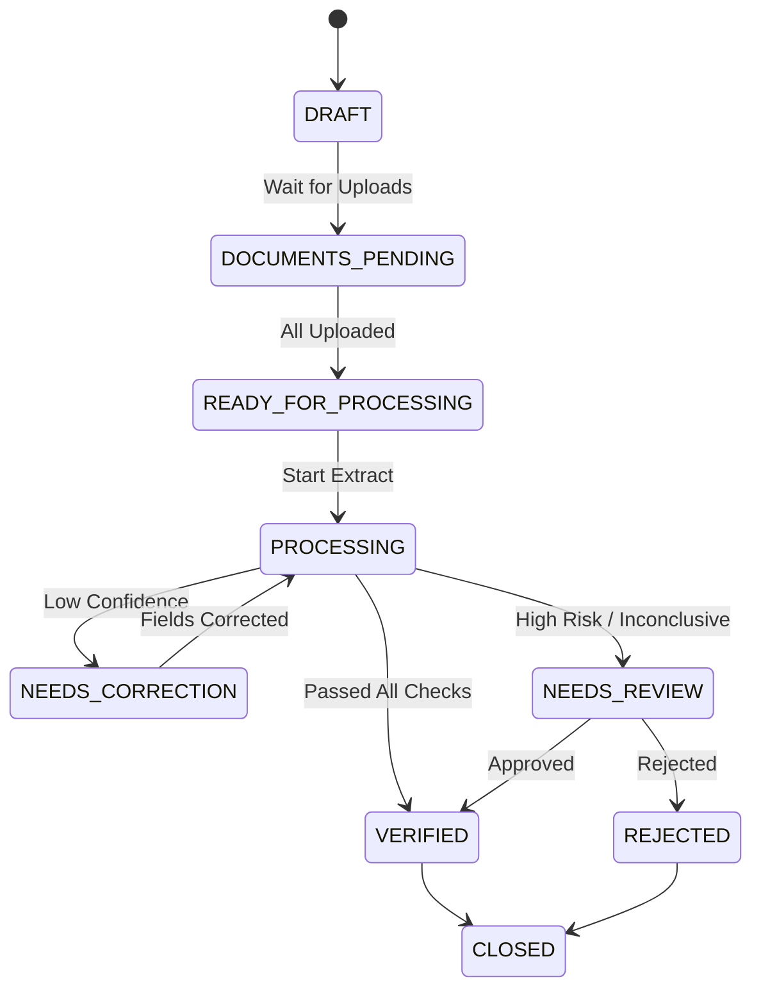
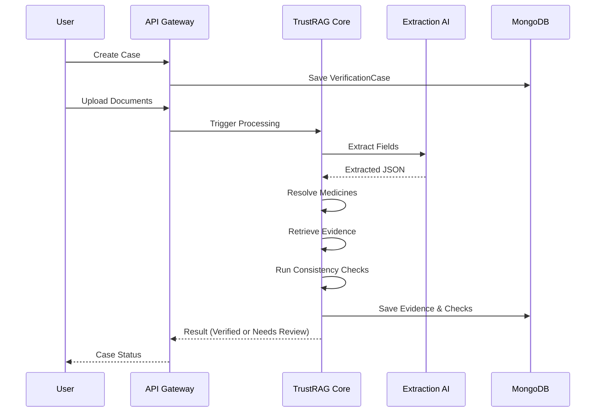
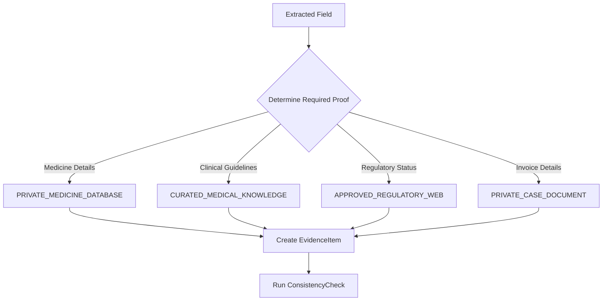
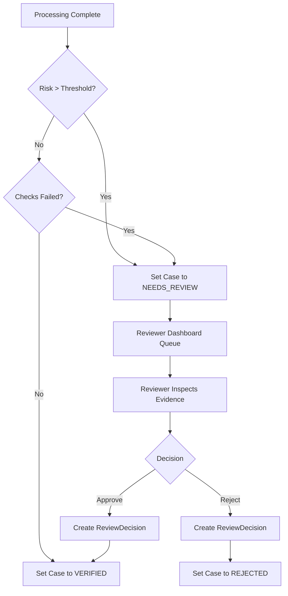

# PharmaVault TrustRAG Domain Model

This document defines the core entities, their properties, enums, and exact workflows for the TrustRAG MVP.

## Core Entities

### VerificationCase
The top-level container for a specific verification instance.
- `id`
- `caseReference`
- `organizationId`
- `branchId`
- `createdBy`
- `subjectReference`
- `status`
- `documentIds`
- `reviewRequired`
- `schemaVersion`
- `createdAt`
- `updatedAt`

### Document
Represents an uploaded file. Never stores raw Base64 content directly in the database.
- `id`
- `caseId`
- `type`
- `objectStorageKey`
- `originalFilename`
- `mimeType`
- `sizeBytes`
- `sha256`
- `pageCount`
- `uploadStatus`
- `processingStatus`
- `uploadedBy`
- `createdAt`

### ExtractedField
A single piece of data extracted from a document by the AI.
- `id`
- `documentId`
- `fieldType`
- `rawValue`
- `normalizedValue`
- `pageNumber`
- `boundingBox`
- `extractionMethod`
- `extractionConfidence`
- `needsCorrection`
- `correctedBy`
- `correctedAt`

### PrescriptionRecord
Structured representation of a parsed prescription.
- Prescriber
- Patient reference
- Prescription date
- Medicine lines
- Dosage
- Frequency
- Duration
- Instructions

### InvoiceRecord
Structured representation of a parsed pharmacy invoice.
- Pharmacy
- Invoice number
- Invoice date
- Medicine lines
- Batch
- Quantity
- Unit price
- Total

### ClaimRecord
Structured representation of a parsed health-claim form.
- Claim reference
- Claim type
- Service dates
- Claimed medicine lines
- Claimed amount
- Claim status

### CanonicalMedicine
The source of truth for normalized medical taxonomy.
- `id`
- `brandName`
- `genericName`
- `strength`
- `strengthUnit`
- `dosageForm`
- `manufacturer`
- `regulatoryIdentifiers`
- `sourceVersion`
- `aliases`

### EvidenceSource
A designated, allow-listed source of truth used during retrieval.
- `id`
- `sourceType`
- `name`
- `authority`
- `baseUrl`
- `trustTier`
- `allowed`
- `lastVerifiedAt`
- `version`

**Source types:**
- `PRIVATE_CASE_DOCUMENT`
- `PRIVATE_MEDICINE_DATABASE`
- `CURATED_MEDICAL_KNOWLEDGE`
- `APPROVED_REGULATORY_WEB`

### EvidenceItem
A specific piece of evidence retrieved from an `EvidenceSource` to support a decision.
- `id`
- `caseId`
- `sourceId`
- `documentId`
- `claimSupported`
- `evidenceText`
- `pageNumber`
- `boundingBox`
- `sourceUrl`
- `retrievedAt`
- `contentHash`
- `sourceVersion`
- `trustTier`

### ConsistencyCheck
A deterministic rule or AI-driven evaluation against the extracted data.
- `id`
- `caseId`
- `checkType`
- `status`
- `severity`
- `message`
- `evidenceItemIds`
- `rulesetVersion`
- `reviewRequired`

### RiskSignal
An indicator of potential risk. Not an allegation or proven fraud.
- `id`
- `caseId`
- `signalType`
- `severity`
- `description`
- `evidenceItemIds`
- `detectedBy`
- `rulesetVersion`
- `reviewRequired`

### ReviewDecision
The outcome of a human-in-the-loop review.
- `id`
- `caseId`
- `reviewerId`
- `decision`
- `reasonCode`
- `notes`
- `evidenceItemIds`
- `createdAt`

### AuditEvent
An append-only immutable record of actions taken on a case.
- `id`
- `caseId`
- `actorId`
- `actorRole`
- `action`
- `targetType`
- `targetId`
- `metadata`
- `createdAt`

---

## Enums and Lifecycles

### Case Status
- `DRAFT`
- `DOCUMENTS_PENDING`
- `READY_FOR_PROCESSING`
- `PROCESSING`
- `NEEDS_CORRECTION`
- `NEEDS_REVIEW`
- `VERIFIED`
- `REJECTED`
- `CLOSED`
- `FAILED`

### Document Type
- `PRESCRIPTION`
- `PHARMACY_INVOICE`
- `CLAIM_FORM`

### Check Status
- `PASS`
- `FAIL`
- `INCONCLUSIVE`
- `NOT_APPLICABLE`

### Severity
- `INFO`
- `LOW`
- `MEDIUM`
- `HIGH`
- `CRITICAL`

### Review Decision
- `APPROVE`
- `REJECT`
- `REQUEST_CLARIFICATION`
- `ESCALATE`

---

## Visual Architecture Diagrams

### 1. Entity Relationship Diagram

### 2. Case Lifecycle

### 3. Golden-Path Sequence

### 4. Evidence-Routing Flow

### 5. Human-Review Escalation Flow

