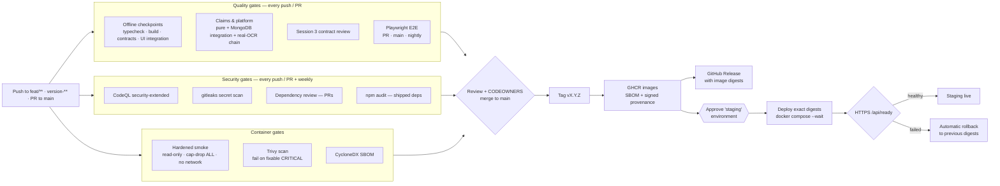

# CI/CD pipeline (version-4.0)

Every change goes through the same automated gates. Releases ship immutable, scanned and
attested container images, and staging is deployed only after a human approves.



## Workflows

| Workflow | File | Runs on | Blocks on |
| --- | --- | --- | --- |
| Offline checkpoint checks | `checkpoints.yml` | push to `main`, `version-**`, `feat/**`, `feature/**`, `wip/**`; PR | typecheck, frontend build, JSON contracts, UI integration, RAG client tests |
| Claims module and platform checks | `claims-platform.yml` | push / PR | claims pure + contract parity, MongoDB integration (claims, review, account security, audit chain, data rights), real-OCR claim chain, OpenAPI + schema validation |
| Session 3 independent contract review | `session3-review.yml` | push / PR | review-workflow contract checks |
| Playwright end-to-end | `e2e.yml` | PR, push to `main`, nightly | full browser journeys on seeded synthetic data |
| Security scanning | `security.yml` | push / PR, weekly | CodeQL alerts, leaked secrets, new vulnerable or GPL-3/AGPL dependencies, high/critical advisories in shipped dependencies |
| Containers | `containers.yml` | push / PR on app paths, weekly | hardened container smoke, fixable CRITICAL CVEs; uploads Trivy report + SBOM |
| Release and deploy | `release.yml` | tag `vX.Y.Z`, manual | builds and publishes images, release notes, gated staging deploy with rollback |

All third-party actions are pinned to full commit SHAs; Dependabot proposes weekly grouped
updates for npm (web and API), GitHub Actions and Docker base images. Every job starts with the
minimum token permissions (`contents: read`) and adds only what it needs.

## One-time repository settings (owner)

1. **Branch protection for `main`** (Settings → Branches → Add rule):
   - Require a pull request with **1 approval** and **Require review from Code Owners**.
   - Require status checks: `offline-acceptance`, `claims-platform`, `e2e`, `CodeQL (JavaScript / TypeScript)`,
     `Secret scan (gitleaks)`, `Dependency review (new packages in this PR)`, `Production dependency audit`,
     `api image`, `web image`, and the Session 3 review job.
   - Require branches to be up to date; block force pushes and deletions.
2. **Private vulnerability reporting**: Settings → Code security → enable (referenced by `SECURITY.md`).
3. **Staging environment** (Settings → Environments → `staging`): add a required reviewer; add
   - variables: `STAGING_DOMAIN` (e.g. `staging.example.org`), optional `STAGING_DEPLOY_DIR` (default `/opt/pharmavault`);
   - secrets: `STAGING_HOST`, `STAGING_USER`, `STAGING_SSH_KEY` (deploy-only key), `STAGING_KNOWN_HOSTS`
     (output of `ssh-keyscan <host>`, checked by hand — no trust-on-first-use).
   Until `STAGING_DOMAIN` is set, the deploy job is skipped and releases still publish images.
4. **Staging VM**: Docker with the compose plugin, `./backend/.env.staging` (never committed) and
   `./backend/tessdata/eng.traineddata` in the deploy directory, and `docker login ghcr.io` with a
   read-only package token if the GHCR packages are private.

## Releasing

```bash
git checkout main && git pull
git tag -a v4.0.0 -m "PharmaVault TrustRAG 4.0.0"
git push origin v4.0.0
```

The run publishes `ghcr.io/aniket889999/pharmavault-api` and `pharmavault-web` (tags `4.0.0`, `4.0`,
`sha-<commit>`), each with an SBOM and a signed provenance attestation
(`gh attestation verify oci://ghcr.io/aniket889999/pharmavault-api@sha256:… --owner aniket889999`),
creates the GitHub Release listing the digests, then waits for approval to deploy staging.

## Rollback

The deploy keeps the running digests in `.deployed` and the previous ones in `.previous` on the VM.
A failed health check restores `.previous` automatically. To roll back by hand, re-run the release
workflow for the older tag, or on the VM: `cp .previous .deployed && set -a && . ./.deployed && set +a &&
docker compose -f docker-compose.staging.yml up -d --no-build --wait`.

## Limits (honest scope)

Staging only; there is no production deployment, and all data is synthetic. Settlement is simulated.
The container smoke tests run without a database or network; the full HTTPS path is checked by the
staging health check, not in CI.
